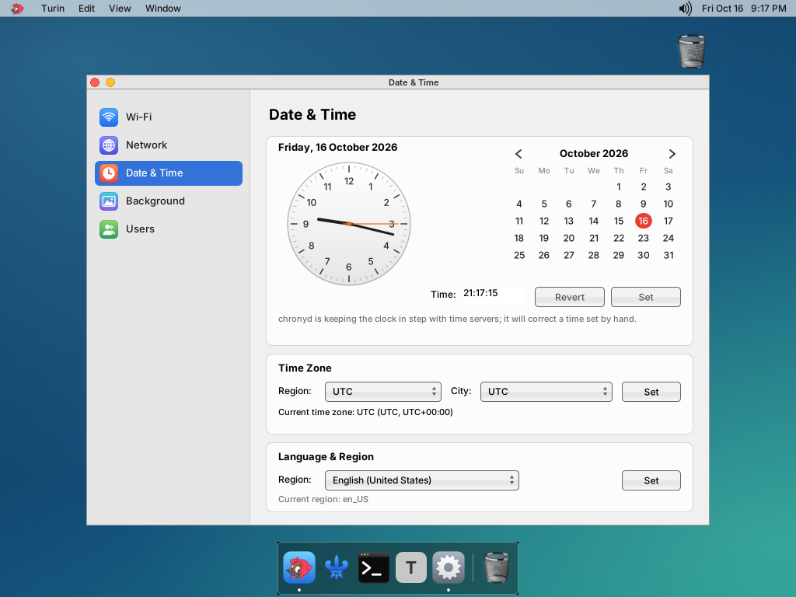

<p align="center"></p>

# Turin

**System Preferences for a small Darwin desktop.** Turin is the settings app for the GNUstep + Window Maker desktop on the Raspberry Pi 3 port of Darwin/XNU (the sibling repository [iokit](https://github.com/anurodhp/xnu-iokit-pi3)), alongside [Milan](https://github.com/anurodhp/milan) (files and desktop) and [Naples](https://github.com/anurodhp/naples) (dock and menu bar). Pure AppKit + libdispatch.

One window: a sidebar of panes with colourful icons on the left, the chosen pane on the right. ⌘1–⌘5 (View menu) or the arrow keys switch panes; `-TurinPane Users` opens on a given one.

## Panes

**Wi-Fi.** An on/off switch; the network in use with its details (IP address, router, BSSID, channel and band, security, 802.11 protocol, RSSI, noise, transmit rate); Disconnect and Forget This Network…; the networks in range, strongest first, with signal and a lock on secured ones. Double-click or Join to join one (a password dialog for a secured network that is not the remembered one); Other Network… joins a hidden one by name. It is Naples' Wi-Fi model (`NaplesWifi.m`) without the menu-bar panel: the same driver calls and the same files (`/etc/wifi.conf`, `/etc/wifi.off`), so Naples and Turin always agree.

**Network.** Every interface (Ethernet, Wi-Fi, loopback, others) with a coloured status (connected, self-assigned, not connected, inactive), and for the chosen one: how IPv4 is configured (DHCP or by hand), address, subnet mask, router, DNS servers and search domains, IPv6 addresses, MAC address, MTU, bytes and packets sent and received, the computer name. Refreshed every 3 s while shown. Read-only.

**Date & Time.** An analog clock and a month calendar: pick a day, type a time, Set (`settimeofday`, and `/var/db/fake-hwclock` so it survives a restart). It says whether chronyd is keeping time. **Time Zone**: region and city from the system's `zone.tab`; Set links `/var/db/timezone/localtime` (this libc's default) and `/etc/localtime` (gnustep-base's) to the zone. **Language & Region**: sets the GNUstep `Locale` and `NSLanguages` defaults for the user.

**Background.** Milan's desktop background: a live preview, placement (Fill, Fit, Stretch, Center, Tile), a colour, and the pictures (Milan's wallpapers and `~/Pictures`; drop pictures on the list to add them). It is Milan's own Desktop Background panel (`MilanWallpaper.m`) as a pane, writing Milan's defaults.

**Users.** The accounts (root and uid 500 and up), with initials avatars. Add (full name, account name, password, administrator), change full name, login shell, administrator and password, and delete (optionally with the home folder). Administrators are members of `admin` (gid 80), as on macOS; new accounts get primary group `staff` and a home under `/Users`.

## What you cannot do (yet)

- Changing Wi-Fi, the clock, the time zone or accounts needs root (the usual session on the image). For other users those controls are disabled; there is no authorization prompt.
- Network is read-only: no manual IPv4, DNS or location settings.
- Time zone and language changes reach applications started afterwards; running ones (Naples' clock included) keep what they read at launch.
- No 12/24-hour or date-format settings: gnustep-base here is built without ICU, so `Locale` changes little beyond the language order.
- Without the full zone database on the image (iokit's `inject_into_sd_image.sh` copies it from the build Mac) only UTC is offered.
- User pictures are initials only; no Login Items, no automatic login, no groups other than `admin`.
- Darwin only, and building needs a Mac and the iokit toolchain.

## How it works

- Every blocking call (Wi-Fi driver calls, `ipconfig`, interface reads) runs on a serial GCD queue and hands its result back with `performSelectorOnMainThread`, because the GNUstep run loop does not drain the main dispatch queue (as in Naples).
- **Wi-Fi** talks to iokit's `BCM43430Wifi` driver through its user client, IOKitLib opened with `dlopen` from `/usr/lib/libiokituser.dylib`; the ABI header is iokit's `iokit/BCM43430Wifi/BCM43430WifiShared.h`, which `build_turin.sh` puts on the include path. A join remembers the network in `/etc/wifi.conf` (mode 600) and gets an address with `ipconfig set en1 DHCP`. Status is polled every 2 s while the pane shows (every 10 s otherwise), with a rescan every 15 s.
- **Network** reads `getifaddrs` (addresses, `AF_LINK` hardware address and `if_data` counters), `ipconfig getoption <if> router`, `ipconfig getpacket <if>` (a DHCP lease) and `/etc/resolv.conf`.
- **Background** writes Milan's defaults domain (`MilanWallpaperPath`, `MilanWallpaperFill`, `MilanWallpaperColor`) and posts the distributed notification `MilanWallpaperChanged`; Milan re-reads its defaults on it and redraws the desktop (and republishes the root pixmap Naples blends over). Milan posts the same notification for changes made in its own panel, and the pane follows. It needs gdnc, which the session autostart starts before Naples; without it the change shows when Milan next starts.
- **Users** goes through FreeBSD `pw(8)` (`/usr/sbin/pw`): `useradd`, `usermod`, `userdel`, `groupmod admin -m/-d`. pw's own hashing (`-h`) fails on the image ("setting crypt(3) format"; its crypt(3) is DES only), so Turin hashes passwords itself with the image's extended-DES hasher (`crypt_des.c`, copied from iokit's `tools/libinfo_custom`, the code that provisions root's password) and hands pw the hash with `-H 0`.
- Child processes are run with `posix_spawn`. Once any NSTask runs in a process, gnustep-base reaps every child on SIGCHLD and their exit status is lost; Turin starts no NSTask, gdnc is started by the session rather than on demand, and where a status is lost anyway Turin judges the run by its output (pw prints nothing on success).
- Dialogs are drawn over the window (Milan's `MilanDialog` approach): Eau shows NSAlerts without waiting for an answer.

## Building

You need a Mac with **Xcode 12** (the iPhoneOS SDK the port is built with) and a current Xcode for its linker, and the [iokit](https://github.com/anurodhp/xnu-iokit-pi3) repository checked out next to this one (`../iokit`, or set `IOKIT_DIR`) with its toolchain and GNUstep libraries already built.

```sh
./build.sh            # cross-build; Turin.app lands in iokit's libc_build/gnustep/root
./build.sh deploy     # build, then copy Turin.app to the Pi
```

`deploy` uses `DEPLOY_HOST` (default `root@10.0.0.142`). iokit's `build_everything.sh` builds it with `tools/userland_staging/build_turin.sh`, and `inject_into_sd_image.sh` puts it on the image as `/Applications/Turin.app` (Window Maker's root menu has it as System Preferences).

`tests/turin_qemu_test.sh <image>` boots an injected iokit image in QEMU, opens every pane under Xvfb, creates a user through the New User dialog and copies the screenshots back to `tests/out/`.

The app icon is drawn by `tools/make_icon.m` (host tool; see its header).

## Layout

| | |
|---|---|
| `main.m` | the application, menus, the starting pane |
| `TurinWindow.m` | the window and its sidebar |
| `TurinPane.m` | the pane base class and the overlay dialogs |
| `TurinWifi.m`, `TurinWifiPane.m` | Wi-Fi: the driver model (from Naples) and the pane |
| `TurinNetworkPane.m` | Network |
| `TurinDateTimePane.m` | Date & Time: clock, calendar, time zone, language and region |
| `TurinBackgroundPane.m`, `TurinImage.m` | Background (from Milan), and Milan's JPEG-capable image loader |
| `TurinUsersPane.m`, `crypt_des.c` | Users, and the image's password hasher |
| `TurinIcons.m` | the sidebar icons, Wi-Fi fan, padlock and avatars, all drawn |
| `TurinUtil.m` | running tools, the main-thread hand-off, labels, the switch |

## Licence

Turin is MIT licensed, except `crypt_des.c`/`crypt_des.h` (APSL 2.0 and BSD; see `LICENSE`).
